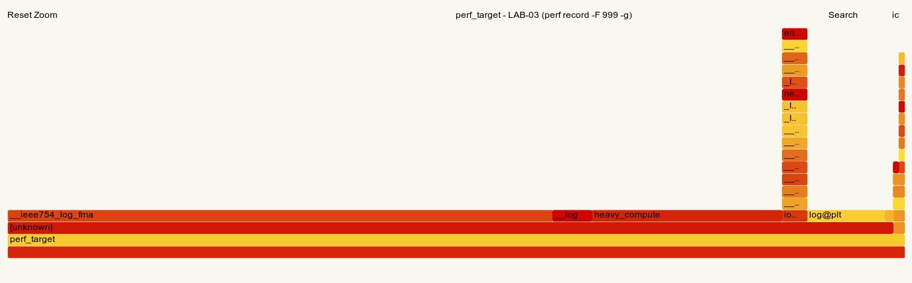
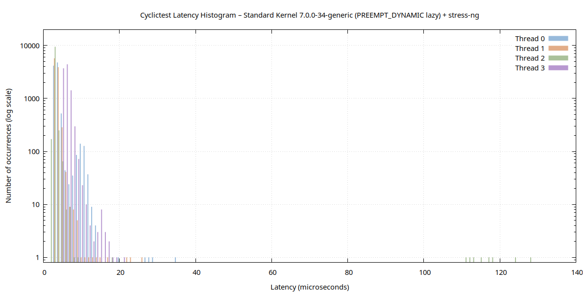
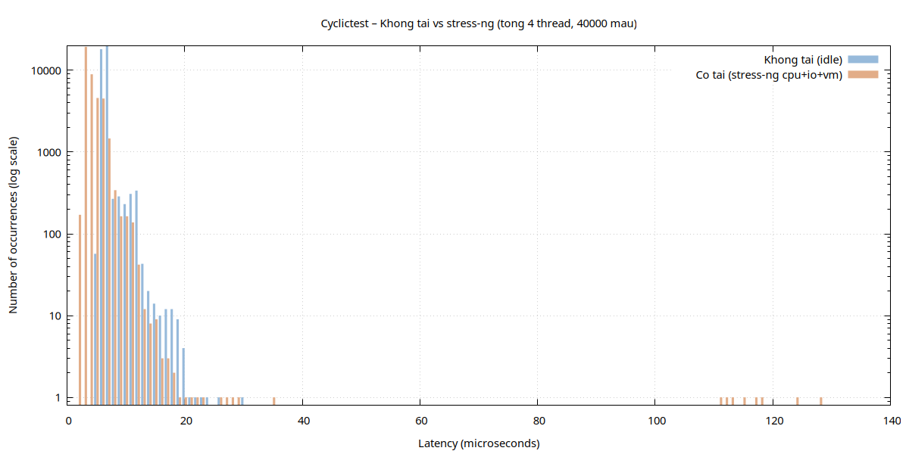
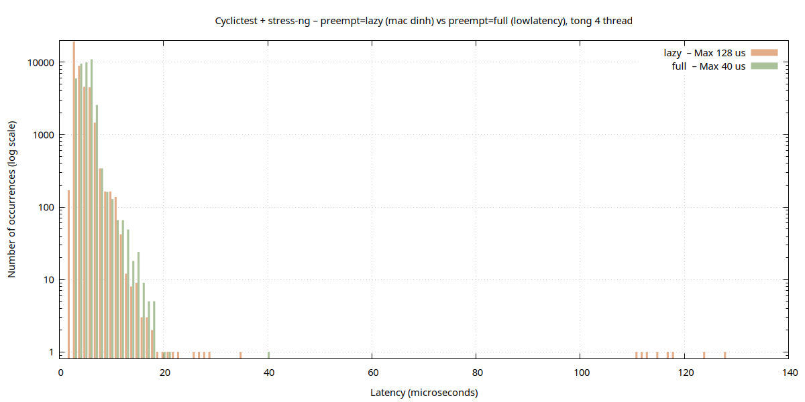

# BÁO CÁO LAB-03: Debugging Kernel & Phân tích Hiệu năng Ứng dụng Nhúng
## Embedded Linux Systems

---

## Mục 1: Thông tin sinh viên và môi trường

| Mục | Nội dung |
|---|---|
| Họ và tên | Trần Đức Kiên |
| MSSV | SE183502 |
| Ngày thực hiện | 12/10/2026 |
| Kiến trúc mục tiêu | ARMv7-A – Cortex-A9 (QEMU vexpress-a9, 512 MB, 2 CPU) |
| Kernel target | Linux 5.15.0 (zImage từ LAB-01) |
| Kernel host | Linux 7.0.0-34-generic, `PREEMPT_DYNAMIC` (mặc định `lazy`; đo thêm `preempt=full`), không có `PREEMPT_RT` |
| CPU host | 13th Gen Intel Core i7-13620H, 16 luồng (kiến trúc lai P-core/E-core) |
| QEMU | 10.2.1 |
| Toolchain | `arm-linux-gnueabihf-gcc` 15.2.0 (target), `gcc` 15.2.0 (host), glibc 2.43 |
| GDB | `gdb-multiarch` 17.1 (host) – `gdbserver` 17.1 armhf (target) |
| Valgrind | 3.26.0 |
| strace | 6.19 (host và bản armhf trong target) |
| perf | 7.0.14 |
| cyclictest | 2.80 (gói rt-tests 2.9), stress-ng 0.20.01, gnuplot 6.0.2 |

### 1.1. Chuẩn bị rootfs LAB-03

Rootfs LAB-03 được sao chép từ LAB-02 (vẫn tự nạp `lab2_driver.ko` khi boot) và bổ sung:

| Thành phần | Nguồn | Ghi chú |
|---|---|---|
| `/usr/bin/gdbserver` | gói `gdbserver_17.1-2ubuntu1_armhf.deb` (ports.ubuntu.com) | Ubuntu không có gdbserver ARM trong toolchain cross → lấy gói armhf chính thức, giải nén bằng `dpkg-deb -x` |
| `/usr/bin/strace` | gói `strace_6.19+ds-0ubuntu5_armhf.deb` | cần thêm `libtinfo.so.6` (gói `libtinfo6` armhf) |
| `/lib/ld-linux-armhf.so.3`, `libc.so.6`, `libm.so.6`, `libgcc_s.so.1`, `libstdc++.so.6` | `/usr/arm-linux-gnueabihf/lib` (sysroot toolchain) | các ứng dụng và gdbserver đều liên kết động |
| `/etc/hosts`, `/etc/nsswitch.conf` | tự tạo | thiếu 2 file này thì `gdbserver :1234` báo `cannot resolve name` (glibc `getaddrinfo` không phân giải được địa chỉ rỗng) |
| `etc/init.d/rcS` | sửa | thêm `ifconfig eth0 10.0.2.15`, `route add default gw 10.0.2.2` để host kết nối gdbserver qua `hostfwd=tcp::1234-:1234` |

Toàn bộ ứng dụng được build bằng `apps/Makefile` (`make && make initramfs`) → `output/initramfs_lab3.cpio.gz` (4,4 MB).

---

## Mục 2: Phần A – GDB Remote Debug Report

### 2.1. Mô hình kết nối

```
HOST: gdb-multiarch buggy_app ── target remote localhost:1234
            │ TCP (GDB Remote Serial Protocol)
            ▼
QEMU  -net user,hostfwd=tcp::1234-:1234  (NAT, host 10.0.2.2 → guest 10.0.2.15)
            ▼
TARGET: gdbserver :1234 /usr/bin/buggy_app   (ptrace tiến trình buggy_app)
```

Console target khi kết nối (trích `logs/gdb_session.txt`):

```
/ # gdbserver :1234 /usr/bin/buggy_app
Process /usr/bin/buggy_app created; pid = 68
Listening on port 1234
Remote debugging from host 10.0.2.2, port 55550
=== Buggy App v1.0 – LAB-03 Debug Target ===
[TEST1] Processing array of 5 elements
Sum = 2043342486
[TEST2] Creating message
Message: "
[TEST3] Integer calculation
calculate(100000, 100000) = 1410065408
```

Chương trình **không crash** (không có SIGSEGV) nhưng cả 3 kết quả đều sai – đây là loại bug khó nhất vì không có dấu hiệu rõ ràng, cần debugger để tìm nguyên nhân. Toàn bộ lệnh GDB được ghi trong `apps/gdb_cmds.gdb` và chạy tự động bằng `apps/run_gdb.sh` để có log tái lập được.

### 2.2. Kết nối và đặt breakpoint

```
+set architecture arm
The target architecture is set to "arm".
+set sysroot /home/kien/embedded_lab3/rootfs/initramfs
+target remote localhost:1234
0x76fdee58 in _start () from /home/kien/embedded_lab3/rootfs/initramfs/lib/ld-linux-armhf.so.3
+break main
Breakpoint 1 at 0x400732: file buggy_app.c, line 25.
+break process_data
Breakpoint 2 at 0x400682: file buggy_app.c, line 6.
+break create_message
Breakpoint 3 at 0x4006cc: file buggy_app.c, line 14.
+break calculate
Breakpoint 4 at 0x400702: file buggy_app.c, line 21.
```

GDB dừng ngay tại `_start` của dynamic loader (`ld-linux-armhf.so.3`) – nhờ `set sysroot` GDB tìm được symbol của loader và libc ARM trên host.

### 2.3. Bảng tổng hợp 3 bug

| # | Tên bug | Vị trí | Giá trị tại thời điểm lỗi | Nguyên nhân kỹ thuật |
|---|---|---|---|---|
| 1 | Array out-of-bounds read | `buggy_app.c:7` (`i <= len`), đọc tại dòng 8 | `i = 5`, `&data[5] = 0x7efffd04`, `data[5] = 0x79caee00` = **stack canary**, `sum = 2043342486` (đúng phải là 150) | Điều kiện `<=` làm vòng lặp chạy 6 lần, đọc phần tử thứ 6 nằm ngoài mảng `arr[5]` trên stack của `main` |
| 2 | Use-after-free | `buggy_app.c:16–17` (`free(buf); return buf;`) | `buf = 0x422010`; trước `free`: `"Hello Embedded Linux"`; sau `free`: `"\"\004"` | Trả về con trỏ tới vùng heap đã giải phóng; allocator glibc (tcache) ghi metadata đè lên 8 byte đầu của chunk |
| 3 | Integer overflow | `buggy_app.c:21` (`int result = a * b;`) | `a = b = 100000`; đúng: `0x2540be400` (10 000 000 000); thực tế: `r3 = 0x540be400` = **1410065408** | Tích vượt `INT_MAX` (2 147 483 647); lệnh ARM `mul.w` chỉ giữ 32 bit thấp; overflow số có dấu là undefined behavior trong C |

### 2.4. Bug 1 – Array out-of-bounds (watchpoint)

Tại `main`, sau khi khởi tạo mảng:

```
+print arr
$1 = {10, 20, 30, 40, 50}
+print &arr[0]
$3 = (int *) 0x7efffcf0
+print &arr[5]
$4 = (int *) 0x7efffd04
```

`&arr[5] − &arr[0] = 0x14 = 20 byte = 5 × sizeof(int)` → `arr[5]` là ô nhớ ngay sau mảng. Tại `process_data`:

```
Breakpoint 2, process_data (data=0x7efffcf0, len=5) at buggy_app.c:6
+backtrace
#0  process_data (data=0x7efffcf0, len=5) at buggy_app.c:6
#1  0x00400774 in main (argc=1, argv=0x7efffe94) at buggy_app.c:30
+print data[0]@len
$7 = {10, 20, 30, 40, 50}
+print/x data[len]
$10 = 0x572a2100
+print/x __stack_chk_guard
$11 = 0x572a2100
```

**Phát hiện quan trọng:** `data[5]` có giá trị **bằng đúng** `__stack_chk_guard` – đây là *stack canary* do gcc của Ubuntu chèn vào (mặc định bật `-fstack-protector-strong`), đặt ngay sau mảng cục bộ `arr` để phát hiện ghi tràn stack. Bug đọc tràn sang canary. Vì canary được sinh ngẫu nhiên mỗi lần chạy (lần này `0x572a2100`, lần khác `0x79caee00`), nên `Sum` mỗi lần chạy ra một giá trị rác khác nhau. Nếu đây là bug *ghi* tràn (`data[i] = ...`) thì canary bị đổi và chương trình sẽ bị abort bởi `__stack_chk_fail` khi `main` return.

Watchpoint trên biến `i`:

```
+set can-use-hw-watchpoints 0
+watch i
Watchpoint 5: i
+continue
Watchpoint 5: i
Old value = 0
New value = 1
0x004006a2 in process_data (data=0x7efffcf0, len=5) at buggy_app.c:7
...
Old value = 4
New value = 5
0x004006a2 in process_data (data=0x7efffcf0, len=5) at buggy_app.c:7
7	    for (int i = 0; i <= len; i++) {   /* Bug: <= thay vi < */
+print i
$18 = 5
+print sum
$19 = 150
+print/x data[i]
$21 = 0x79caee00
+next
+next
+info locals
i = 5
sum = 2043342486
```

Tại `i = 5` tổng đã đủ 150; lần lặp thừa cộng thêm canary `0x79caee00` (2043342336) → `sum = 2043342486`.

> **Ghi chú kỹ thuật:** lệnh `watch i` ban đầu tạo *hardware watchpoint* nhưng `continue` báo `Could not insert hardware watchpoint 5`. QEMU system-mode không cung cấp debug register cho ptrace của tiến trình trong guest, nên phải dùng `set can-use-hw-watchpoints 0` để GDB chuyển sang *software watchpoint* (single-step từng lệnh và so sánh giá trị – chậm hơn nhưng đúng).

**Đề xuất sửa:** đổi điều kiện thành `i < len`; tốt hơn là dùng `sizeof(arr)/sizeof(arr[0])` khi truyền độ dài và bật `-fsanitize=address` khi test để bắt out-of-bounds ngay lập tức.

### 2.5. Bug 2 – Use-after-free (examine memory)

```
Breakpoint 3, create_message (text=0x400940 "Hello Embedded Linux") at buggy_app.c:14
+backtrace
#0  create_message (text=0x400940 "Hello Embedded Linux") at buggy_app.c:14
#1  0x00400788 in main (argc=1, argv=0x7efffe94) at buggy_app.c:33
+next  /  +next
16	    free(buf);
+print buf
$24 = 0x422010 "Hello Embedded Linux"
+next
17	    return buf;   /* Bug: tra ve pointer da bi free */
+print buf
$25 = 0x422010 "\"\004"
+x/24xb buf
0x422010:	0x22	0x04	0x00	0x00	0x5d	0x2f	0x74	0x06
0x422018:	0x62	0x65	0x64	0x64	0x65	0x64	0x20	0x4c
0x422020:	0x69	0x6e	0x75	0x78	0x00	0x00	0x00	0x00
+finish
Value returned is $26 = 0x422010 "\"\004"
+print $r0
$27 = 4333584
```

- Con trỏ `buf` **không đổi** (`0x422010`) sau `free()` – `free` không xóa con trỏ, chỉ trả vùng nhớ cho allocator.
- 8 byte đầu bị glibc ghi đè: 4 byte đầu là con trỏ `next` của tcache (đã mã hóa *safe-linking*), 4 byte sau là `key` dùng để phát hiện double-free. Phần còn lại (`"bedded Linux"` = `62 65 64 64 65 64 20 4c...`) vẫn là dữ liệu cũ.
- Theo quy ước gọi hàm ARM (AAPCS), giá trị trả về nằm trong `r0` (`4333584 = 0x422010`). `main` in ra `Message: "` – dữ liệu rác.

**Đề xuất sửa:** chỉ `free()` sau khi người gọi dùng xong (chuyển trách nhiệm giải phóng cho `main`), và gán `buf = NULL` ngay sau `free` để biến use-after-free thành NULL dereference dễ phát hiện.

### 2.6. Bug 3 – Integer overflow (registers & disassemble)

```
Breakpoint 4, calculate (a=100000, b=100000) at buggy_app.c:21
+backtrace
#0  calculate (a=100000, b=100000) at buggy_app.c:21
#1  0x004007b4 in main (argc=1, argv=0x7efffe94) at buggy_app.c:37
+print (long long)a * b
$30 = 10000000000
+step
22	    printf("calculate(%d, %d) = %d\n", a, b, result);
+print result
$32 = 1410065408
+print/x result
$33 = 0x540be400
+print/x (long long)a * b
$34 = 0x2540be400
+info registers pc sp lr
pc             0x40070c            0x40070c <calculate+20>
sp             0x7efffcc8          0x7efffcc8
lr             0x4007b5            4196277
```

`info registers` đầy đủ:

```
r0  0x186a0  100000        r1  0x186a0  100000
r2  0x186a0  100000        r3  0x540be400  1410065408
r7  0x7efffcc8             sp  0x7efffcc8
lr  0x4007b5               pc  0x40070c <calculate+20>
cpsr 0x600f0030            fpscr 0x0
```

Mã máy của phép nhân:

```
   0x00400702 <+10>:	ldr	r3, [r7, #4]
   0x00400704 <+12>:	ldr	r2, [r7, #0]
   0x00400706 <+14>:	mul.w	r3, r2, r3
   0x0040070a <+18>:	str	r3, [r7, #12]
=> 0x0040070c <+20>:	ldr	r3, [r7, #12]
```

`mul.w` (Thumb-2) nhân 2 thanh ghi 32 bit và **chỉ giữ 32 bit thấp**: `0x2_540BE400` → `0x540BE400`, bit thứ 33 bị mất. `lr = 0x4007b5` (bit 0 = 1 → trả về chế độ Thumb) trỏ về `main` ngay sau lệnh gọi `calculate`. `cpsr = 0x600f0030`: bit T (bit 5) = 1 xác nhận CPU đang chạy Thumb.

**Đề xuất sửa:** dùng kiểu 64 bit (`long long result = (long long)a * b;`), hoặc kiểm tra tràn bằng `__builtin_mul_overflow(a, b, &result)` và báo lỗi; bật `-fsanitize=undefined` hoặc `-ftrapv` khi test.

---

## Mục 3: Phần B – Memory Analysis Report

### 3.1. LEAK SUMMARY trước khi sửa (`logs/valgrind_report.txt`)

```
HEAP SUMMARY:
    in use at exit: 16,900 bytes in 250 blocks
  total heap usage: 352 allocs, 102 frees, 24,196 bytes allocated

LEAK SUMMARY:
   definitely lost: 16,900 bytes in 250 blocks
   indirectly lost: 0 bytes in 0 blocks
     possibly lost: 0 bytes in 0 blocks
   still reachable: 0 bytes in 0 blocks
        suppressed: 0 bytes in 0 blocks

ERROR SUMMARY: 3 errors from 3 contexts (suppressed: 0 from 0)
```

Kiểm tra số lần cấp phát: 1 (`records`) + 100 × 3 (`Record`, `name`, `scores`) + 50 (`buf`) + 1 (bộ đệm `stdout`) = **352 allocs**. Số lần giải phóng: 100 (`free(r)`) + 1 (`free(records)`) + 1 (bộ đệm `stdout` khi thoát) = **102 frees**. Chênh lệch 250 block = 100 `name` + 100 `scores` + 50 `buf`.

| Loss record | Kích thước | Nơi malloc | Gọi từ |
|---|---|---|---|
| 1 of 3 | 2 000 B / 100 block (20 B = 5 × `int`) | `create_record` – `leaky_app.c:25` (`r->scores`) | `main` – `leaky_app.c:53` |
| 2 of 3 | 2 100 B / 100 block (21 B = `strlen("EmbeddedLinuxStudent") + 1`) | `create_record` – `leaky_app.c:23` (`r->name`) | `main` – `leaky_app.c:53` |
| 3 of 3 | 12 800 B / 50 block (256 B = `MSG_SIZE`) | `process_messages` – `leaky_app.c:39` (`buf`) | `main` – `leaky_app.c:59` |

### 3.2. Phân tích allocation stack trace

**Leak `r->name` (loss record 2):**

```
2,100 bytes in 100 blocks are definitely lost in loss record 2 of 3
   at 0x4850858: malloc (vg_replace_malloc.c:447)
   by 0x400124D: create_record (leaky_app.c:23)
   by 0x4001414: main (leaky_app.c:53)
```

Đọc từ dưới lên: `main` (dòng 53, vòng lặp tạo 100 record) gọi `create_record`, và `malloc` tại dòng 23 cấp phát `name`. Bộ nhớ không được giải phóng vì `delete_record()` chỉ gọi `free(r)` – hai dòng `free(r->name)` và `free(r->scores)` bị comment. Khi `r` bị free, con trỏ `r->name` nằm trong vùng nhớ đã trả lại allocator → không còn con trỏ hợp lệ nào trỏ tới chuỗi → **definitely lost**.

**Leak `buf` (loss record 3):**

```
12,800 bytes in 50 blocks are definitely lost in loss record 3 of 3
   at 0x4850858: malloc (vg_replace_malloc.c:447)
   by 0x4001314: process_messages (leaky_app.c:39)
   by 0x4001487: main (leaky_app.c:59)
```

Mỗi vòng lặp `malloc(256)` và gán vào biến cục bộ `buf`. Sang vòng lặp sau `buf` bị gán con trỏ mới, con trỏ cũ mất vĩnh viễn → mỗi vòng mất 256 byte, 50 vòng mất 12 800 byte. Đây là dạng leak nguy hiểm nhất trong hệ thống nhúng chạy liên tục: bộ nhớ mất **tỉ lệ thuận với số lần xử lý**, sớm muộn sẽ hết RAM.

### 3.3. Sau khi sửa (`apps/leaky_app_fixed.c`, `logs/valgrind_fixed.txt`)

```diff
-    /* free(r->name);   <-- BỊ COMMENT = memory leak */
-    /* free(r->scores); <-- BỊ COMMENT = memory leak */
+    free(r->name);     /* FIX: giai phong name truoc khi free(r) */
+    free(r->scores);   /* FIX: giai phong scores truoc khi free(r) */
     free(r);
...
-        /* free(buf);  <-- BỊ THIẾU */
+        free(buf);   /* FIX: giai phong buffer sau moi vong lap */
```

```
HEAP SUMMARY:
    in use at exit: 0 bytes in 0 blocks
  total heap usage: 352 allocs, 352 frees, 24,196 bytes allocated

All heap blocks were freed -- no leaks are possible

ERROR SUMMARY: 0 errors from 0 contexts (suppressed: 0 from 0)
```

Tổng allocs = tổng frees = 352. ✔

### 3.4. Bộ nhớ của `leaky_app_arm` trong QEMU

Để kịp đọc `/proc/PID/*` (chương trình gốc chạy xong trong vài ms), bản ARM được build với `-DMEASURE`: chương trình dừng 5 giây **trước** khi cấp phát và 5 giây **sau** khi leak (bản host cho Valgrind không bị ảnh hưởng). Memory map của tiến trình (`logs/qemu_measure.txt`):

```
00470000-00471000 r-xp ... /usr/bin/leaky_app_arm      ← text
0048f000-00490000 r--p ... /usr/bin/leaky_app_arm      ← rodata (RELRO)
00490000-00491000 rw-p ... /usr/bin/leaky_app_arm      ← data/bss
00491000-004b3000 rw-p 00000000 00:00 0  [heap]        ← heap 136 KB
76e20000-76f32000 r-xp ... /lib/libc.so.6
76f5f000-76f7b000 r-xp ... /lib/ld-linux-armhf.so.3
7ef84000-7efa5000 rw-p 00000000 00:00 0  [stack]
ffff0000-ffff1000 r-xp 00000000 00:00 0  [vectors]     ← bảng vector ngắt ARM
```

| Chỉ số | Trước khi chạy phần leak | Sau khi leak | Thay đổi |
|---|---|---|---|
| `VmSize` (`/proc/PID/status`) | 1680 kB | 1680 kB | 0 |
| `VmRSS` (`/proc/PID/status`) | 152 kB | 152 kB | 0 |
| `RssAnon` | 32 kB | 32 kB | 0 |
| **`Rss` của vùng `[heap]`** (`/proc/PID/smaps`) | **8 kB** | **28 kB** | **+20 kB** |

Nhận xét:

- `VmSize` không đổi vì heap ban đầu glibc đã xin sẵn 136 kB (`Size: 136 kB`) – 24 KB cấp phát nằm gọn trong vùng này nên không cần `brk()` thêm.
- `VmRSS` **không phản ánh** 20 kB tăng thêm: kernel 5.15 dùng `SPLIT_RSS_COUNTING` – mỗi thread đếm RSS riêng và chỉ cộng dồn vào `mm` sau mỗi 64 sự kiện page fault, nên vài trang mới chưa hiện ra trong `/proc/PID/status`.
- `/proc/PID/smaps` duyệt trực tiếp bảng trang nên chính xác: heap tăng từ 8 kB lên 28 kB (+5 trang 4 KB), khớp với 24 196 byte Valgrind đo được. Đề bài có yêu cầu đọc `VmHeap`, nhưng trường này **không tồn tại** trong `/proc/PID/status` của Linux; số liệu heap phải lấy từ `smaps`.

---

## Mục 4: Phần C – Profiling Report

### 4.1. strace trên host x86_64

`strace -o logs/strace_full.txt ./perf_target` → 122 dòng (120 system call có giá trị trả về + `exit_group(0)` + dòng `+++ exited with 0 +++`).

Lệnh `strace -c` đúng như đề cho cột thời gian **toàn 0** (`logs/strace_summary_default.txt`) vì mặc định strace 6.x đo *system CPU time* và mỗi syscall trên CPU i7 tốn < 1 µs. Dùng thêm `-w` (đo wall-clock) cho số liệu có ý nghĩa (`logs/strace_summary.txt`):

| # | Syscall | % time | Số lần gọi | µs/call |
|---|---|---|---|---|
| 1 | `write` | 28,14 | 70 | 9 |
| 2 | `execve` | 23,66 | 1 | 575 |
| 3 | `mmap` | 13,85 | 14 | 24 |
| 4 | `openat` | 8,65 | 4 | 52 |
| 5 | `munmap` | 7,42 | 3 | 60 |
| | **Tổng** | 100 | **120** (2 lỗi) | 20 |

`time ./perf_target`: `real 0.043s, user 0.041s, sys 0.002s`.

**Quan sát quan trọng:** 10 000 lệnh `fprintf()` chỉ sinh ra **69 lệnh `write(3, ..., 4096)`** (+1 `write(1, ...)` cho `stdout`):

```
write(3, "Line 0: measurement data\nLine 1:"..., 4096) = 4096
write(3, " data\nLine 156: measurement data"..., 4096) = 4096
```

stdio của glibc gom dữ liệu vào bộ đệm 4 KB (bằng `st_blksize` lấy từ `fstat`) rồi mới gọi `write` một lần → giảm số syscall khoảng 145 lần.

### 4.2. strace trên ARM target (QEMU)

`time perf_target_arm` trong QEMU: `real 1.40s, user 1.37s, sys 0.02s` – **chậm hơn host ~33 lần** (QEMU dịch lệnh ARM sang x86 bằng TCG, cộng với CPU Cortex-A9 giả lập).

| # | Syscall | `strace -c` % time | `strace -c -w` % time | Số lần gọi |
|---|---|---|---|---|
| 1 | `write` | 36,69 | 65,47 | 70 |
| 2 | `mmap2` | 17,00 | 5,53 | 10 |
| 3 | `mprotect` | 9,41 | 2,59 | 6 |
| 4 | `munmap` | 6,80 | 4,91 | 6 |
| 5 | `openat` | 6,75 (3 lỗi) | 3,87 | 6 |
| | **Tổng** | 0,0185 s | 0,1095 s | **122** (8 lỗi) |

So sánh host và ARM:

| | x86_64 host | ARMv7 QEMU |
|---|---|---|
| Thời gian chạy | 0,043 s | 1,40 s |
| Tổng syscall | 120 | 122 |
| Số `write` vào file | 69 | 69 (giống hệt – cùng logic stdio 4 KB) |
| µs/call trung bình (`-w`) | 20 | 897 |
| Syscall riêng theo kiến trúc | `mmap`, `arch_prctl`, `fstat`, `prlimit64` | `mmap2` (offset tính theo trang), `set_tls`, `statx`, `ugetrlimit`, `clock_gettime64` (time64 trên 32 bit) |

Mỗi syscall trên QEMU tốn ~45 lần lâu hơn: mỗi lần chuyển user → kernel phải giả lập exception SVC, đổi mode CPU và chạy mã kernel ARM qua TCG.

### 4.3. perf report trên host (`logs/perf_report.txt`, `logs/perf_top_symbols.txt`)

| # | Hàm (symbol) | Shared object | Overhead (self) |
|---|---|---|---|
| 1 | `__ieee754_log_fma` | `libm.so.6` | **66,23 %** |
| 2 | `heavy_compute` | `perf_target` | **17,60 %** |
| 3 | `log@@GLIBC_2.29` | `libm.so.6` | 7,53 % |
| 4 | `__printf_buffer_write` | `libc.so.6` | 1,24 % |
| 5 | `__printf_buffer` | `libc.so.6` | 1,23 % |

Hai điều đáng chú ý khi đối chiếu với mã máy (`objdump -d`):

1. **`sqrt` không xuất hiện** trong report: gcc thay `sqrt()` bằng 1 lệnh phần cứng (`sqrtsd` trên x86, `vsqrt.f64` trên ARM) ngay trong `heavy_compute`; `sqrt@plt` chỉ được gọi khi đối số âm (để đặt `errno`). Do đó thời gian `sqrt` nằm trong 17,6 % của `heavy_compute`, còn **`log()` mới là hotspot thật** (66,23 + 7,53 + 1,19 ≈ 75 %).
2. **`linear_search` không xuất hiện:** trong `main` không còn lệnh `call linear_search`. Với `-O1`, gcc thấy hàm không có side effect và kết quả trả về bị bỏ đi nên **xóa toàn bộ vòng lặp 1000 lần tìm kiếm**. Muốn đo hàm này phải dùng kết quả (ví dụ cộng dồn vào biến `volatile`).

> Phần call graph (`perf record -g`) hiện địa chỉ rác dạng `0x40eb178000000000` vì `-O1` bỏ frame pointer, perf không lần ngược được stack. Cần build với `-fno-omit-frame-pointer` hoặc dùng `perf record --call-graph dwarf`.

### 4.4. perf stat (`logs/perf_stat.txt`)

| Counter | Giá trị | Ý nghĩa |
|---|---|---|
| `task-clock` | 49,73 ms (0,9 CPU) | gần như toàn bộ thời gian là CPU |
| `cpu_core/instructions` / `cycles` | 381,4 M / 78,9 M → **IPC = 4,8** | rất cao (> 1,5 là tốt) – vòng lặp tính toán thuần, pipeline P-core gần như không bị nghẽn |
| `branch-misses` (P-core) | 5 606 / 52,7 M = **0,0 %** | vòng lặp đơn giản, dự đoán nhánh gần tuyệt đối |
| TopdownL1 (P-core) | retiring 81,6 %, backend bound 12,1 %, frontend 5,9 %, bad speculation 0,4 % | phần lớn chu kỳ thực thi lệnh hữu ích |
| `page-faults` | 379 | chủ yếu do khởi tạo 2 mảng 800 KB + 400 KB |
| `context-switches` | 2 | |
| user / sys | 0,049 s / 0,002 s | **96 % user time** |

CPU i7-13620H là kiến trúc lai: perf đếm riêng P-core (`cpu_core`, 98 % thời gian) và E-core (`cpu_atom`, 1,6 %).

### 4.5. Flame graph (Bonus – `logs/flamegraph.svg`)



Thanh rộng nhất là `__ieee754_log_fma`, tiếp theo là `heavy_compute`; nhánh `io_intensive` (ghi file) chỉ là một cột hẹp.

### 4.6. Kết luận: bottleneck là CPU hay I/O?

**Bottleneck là CPU.** `user` chiếm 96 % thời gian, `sys` chỉ 4 %; toàn bộ syscall chỉ tốn 2,4 ms (`strace -c -w`) trên tổng 43–50 ms, và 75 % CPU nằm trong `log()`. Phần I/O đã được stdio tối ưu sẵn (69 `write` cho 10 000 dòng).

Đề xuất tối ưu: (1) giảm số lần gọi `log()` – kết quả `heavy_compute` giống nhau qua 50 vòng nên chỉ cần tính 1 lần (giảm 50×); (2) dùng `logf`/`sqrtf` (single precision) hoặc bảng tra/xấp xỉ đa thức nếu chấp nhận sai số; (3) vector hóa bằng NEON trên ARM (`-O3 -mfpu=neon -ffast-math`) – xem Câu 3.

---

## Mục 5: Phần D – Real-Time Latency Report

### 5.1. Cấu hình đo

- Kernel host: `Linux 7.0.0-34-generic #34-Ubuntu SMP PREEMPT_DYNAMIC`. `CONFIG_PREEMPT_DYNAMIC=y`, `CONFIG_PREEMPT_LAZY=y`, `# CONFIG_PREEMPT_RT is not set`; chế độ chạy khi boot: `Dynamic Preempt: lazy`.
- Lệnh: `cyclictest --mlockall --threads=4 --priority=80 --interval=1000 --distance=500 --loops=10000 --histogram=200` (cyclictest báo `distance is ignored and set to 0, if histogram enabled` – khi bật histogram, 4 thread cùng chu kỳ 1000 µs).
- Tải: `stress-ng --cpu 16 --io 4 --vm 2 --vm-bytes 256M --timeout 60s` chạy song song. Đo thêm 1 lần **không tải** để làm mốc.

### 5.2. Bảng thống kê

| Chỉ số | Standard kernel – có tải stress-ng | Tham chiếu: không tải |
|---|---|---|
| Min latency (µs) | **2** (T0 3, T1 3, T2 2, T3 5) | 5 |
| Avg latency (µs) | **4,1** (T0 3, T1 3, T2 3, T3 5) | 6,7 |
| Max latency (µs) | **128** (T0 35, T1 26, **T2 128**, T3 21) | 30 |
| Mẫu < 50 µs | 99,98 % (39 993 / 40 000) | 100 % |
| Histogram overflow | 0 | 0 |
| Kernel version | 7.0.0-34-generic | |
| PREEMPT config | `PREEMPT_DYNAMIC` (lazy), không có `PREEMPT_RT` | |
| CPU load khi đo | stress-ng (cpu + io + vm) | không tải |

Lệnh awk theo đề (thread 0): `Max latency: 35 us`, `100.0% samples < 50us`.

### 5.3. Histogram latency





(Trục Y dùng thang log để thấy được các mẫu hiếm ở đuôi phân phối.)

### 5.4. Phân tích

- **Phân phối:** gần như toàn bộ mẫu nằm trong 2–15 µs, nhưng thread 2 có một cụm **7 mẫu ở 111–128 µs** – đây là *latency spike* điển hình: rất hiếm (0,02 %) nhưng lớn gấp ~30 lần Avg. Cụm liền nhau gợi ý một sự kiện kéo dài vài ms trên CPU đó (ví dụ một đoạn kernel không preempt được của stress-ng `--vm`/`--io`, hoặc softirq xử lý dồn).
- **Có tải lại có Avg thấp hơn không tải** (4,1 so với 6,7 µs): khi không tải, CPU rảnh đi vào C-state sâu, mỗi lần timer đánh thức phải tốn thêm thời gian thoát C-state và tăng tần số; khi stress-ng chạy, CPU luôn thức. Đây là lý do hệ thống RT thật thường tắt C-state sâu (`intel_idle.max_cstate=1`, `processor.max_cstate=1`).
- **Max mới là chỉ số quan trọng:** dưới tải, Max tăng từ 30 lên 128 µs dù Avg giảm – Avg hoàn toàn không cho biết worst case.

### 5.5. So sánh thực nghiệm: standard (`preempt=lazy`) vs lowlatency (`preempt=full`)

Trên Ubuntu 26.04 không còn kernel lowlatency riêng: gói `linux-lowlatency` chỉ là kernel `generic` cộng gói `lowlatency-kernel` thêm tham số khởi động. Kernel host có `CONFIG_PREEMPT_DYNAMIC=y` nên mô hình preemption chọn được lúc boot bằng `preempt=none|voluntary|full|lazy`.

- Đổi lúc đang chạy qua `/sys/kernel/debug/sched/preempt` **không được**: máy bật Secure Boot → kernel ở chế độ `lockdown=integrity` (`/sys/kernel/security/lockdown`: `none [integrity] confidentiality`), chặn debugfs kể cả với root (`Operation not permitted`).
- Vì vậy thêm `preempt=full` vào `GRUB_CMDLINE_LINUX_DEFAULT` (script `set_preempt_boot.sh`), khởi động lại, xác nhận `dmesg`: `Dynamic Preempt: full`, đo bằng **cùng lệnh cyclictest + stress-ng** (`run_preempt_modes.sh`), rồi trả GRUB về như cũ.

| Chỉ số (có tải stress-ng, 4 × 10 000 mẫu) | `lazy` – mặc định ("standard") | `full` – "lowlatency" |
|---|---|---|
| Min (µs) | 2 | 3 |
| Avg (µs) | **4,11** | 4,97 |
| P99 (µs) | 9 | 9 |
| P99.9 (µs) | 14 | 15 |
| **Max (µs)** | **128** (T2) | **40** (T0) |
| Số mẫu ≥ 20 µs | 17 | 3 |
| Max từng thread (µs) | 35 / 26 / 128 / 21 | 40 / 17 / 20 / 21 |



Nhận xét:

- **Phần thân phân phối gần như trùng nhau** (P99 = 9 µs ở cả hai): với task `SCHED_FIFO` priority 80, cả `lazy` lẫn `full` đều preempt ngay task thường trong user space. Khác biệt chỉ nằm ở **đuôi**.
- **`full` cắt đuôi:** Max giảm từ 128 xuống 40 µs (~3,2 lần), số mẫu ≥ 20 µs giảm từ 17 xuống 3. Ở `lazy`, khi task thường đang chạy *trong kernel* (stress-ng `--io`, `--vm` gọi rất nhiều syscall, page fault), kernel chỉ đặt cờ "cần lập lịch" và chờ tới tick hoặc điểm trả về user space; ở `full` kernel preempt ngay tại bất kỳ điểm nào không giữ spinlock. Cụm 111–128 µs của `lazy` chính là các khoảng chờ này.
- **Cái giá:** Avg tăng ~0,9 µs (4,1 → 5,0) vì preempt thường xuyên hơn → nhiều context switch hơn, throughput giảm nhẹ. Đây là lý do Ubuntu mặc định `lazy` cho desktop/server, còn kernel lowlatency (`full`) dành cho audio, điều khiển.
- **Giới hạn của phép đo:** mỗi chế độ chỉ đo 1 lần 10 giây ở 2 lần boot khác nhau; Max là giá trị cực trị nên dao động mạnh giữa các lần chạy. Kết luận "`full` giảm Max" cần lặp lại nhiều lần và đo dài hơn để chắc chắn; tuy nhiên chiều hướng phù hợp với lý thuyết. `full` vẫn **không phải** PREEMPT_RT: spinlock, hard IRQ, softirq vẫn không bị preempt (xem 5.7).

### 5.6. Tại sao Max latency quan trọng hơn Avg trong hệ thống real-time?

Real-time nghĩa là **đảm bảo deadline**, không phải "chạy nhanh trung bình". Một bộ điều khiển chu kỳ 1 ms đúng hạn 9 999 lần nhưng trễ 1 lần vẫn là hệ thống lỗi (với hard RT – ví dụ phanh ABS, điều khiển động cơ – một lần trễ có thể gây hỏng hóc). Thiết kế phải dựa trên WCET + worst-case latency: deadline > Max latency + thời gian xử lý. Avg chỉ phản ánh *throughput*; hai hệ thống cùng Avg 4 µs có thể có Max 20 µs hoặc 2 ms. Vì vậy cyclictest báo cáo Max và histogram (hình dạng đuôi), không chỉ trung bình.

### 5.7. Cơ chế PREEMPT_RT giúp giảm Max latency

| Nguồn latency trong standard kernel | PREEMPT_RT xử lý |
|---|---|
| Hard IRQ handler chạy với ngắt bị tắt, không bị preempt | *Threaded IRQ*: handler chuyển thành kernel thread có priority, task RT ưu tiên cao hơn có thể chạy trước |
| `spinlock_t` tắt preemption trong toàn bộ critical section | `spinlock_t` thành *rt_mutex* (sleeping lock) – có thể bị preempt; chỉ `raw_spinlock_t` còn tắt preemption, và rất ngắn |
| Softirq (network, block, timer) chạy dồn ở cuối ngắt hoặc trong `ksoftirqd` | Softirq chạy trong ngữ cảnh thread, có thể lập lịch và ưu tiên |
| Priority inversion: task thấp giữ lock mà task RT cần | *Priority inheritance* trên rt_mutex: task giữ lock được tạm nâng priority |
| Đoạn non-preemptible dài (`preempt_disable`, RCU) | Thu gọn tối đa, RCU preemptible, chế độ `PREEMPT_RT` gần như toàn bộ kernel preemptible |

Kết quả: thời gian tối đa từ lúc timer hết hạn đến lúc task RT được chạy bị chặn trên bởi đoạn non-preemptible ngắn nhất còn lại, nên Max latency thường giảm từ hàng trăm µs–ms xuống vài chục µs và histogram hẹp lại.

### 5.8. Đề xuất cho hệ thống điều khiển robot yêu cầu response < 500 µs

Nên dùng **kernel PREEMPT_RT** (từ Linux 6.12, PREEMPT_RT đã được merge vào mainline; trên Ubuntu 26.04 có sẵn gói `linux-image-realtime` 7.0.0-34 trong kho). Lý do:

- Kết quả đo: standard (`lazy`) Max 128 µs, lowlatency (`full`) Max 40 µs trong 10 giây đo – đều đạt 500 µs *trong phép thử này*, nhưng cả hai **không có cận trên được bảo đảm**: với thời gian chạy dài (hàng giờ), tải I/O khác (USB, mạng, GPU, ghi đĩa) Max có thể lên hàng ms. `full` chỉ là bước trung gian; PREEMPT_RT mới loại bỏ được spinlock/IRQ/softirq không preempt được.
- Biên an toàn: 500 µs là tổng response gồm cả latency lập lịch + thời gian tính toán điều khiển + I/O tới driver động cơ; latency lập lịch nên chỉ chiếm phần nhỏ (< 50–100 µs) và ổn định.
- Cấu hình kèm theo: chạy thread điều khiển `SCHED_FIFO` priority cao, `mlockall()`, cô lập CPU (`isolcpus`, `nohz_full`, IRQ affinity sang CPU khác), tắt C-state sâu và frequency scaling; kiểm chứng lại bằng cyclictest chạy dài (≥ 24 h) dưới tải thực tế.

(Chế độ lowlatency đã được đo thực tế ở mục 5.5. Kernel PREEMPT_RT không được cài để đo vì đề bài xếp là bài tập nâng cao, và trên máy này kernel realtime không có driver NVIDIA, cần sửa GRUB và khởi động lại; phần PREEMPT_RT được phân tích lý thuyết như mục D.5.)

---

## Mục 6: Trả lời câu hỏi phân tích

### Câu 1. Chuỗi sự kiện khi gõ `next`, giao thức GDB – gdbserver, vì sao cần gdb-multiarch

**Chuỗi sự kiện khi gõ `next`** (ví dụ từ dòng 7 sang dòng 8 trong `process_data`):

1. **GDB (host)** đọc bảng dòng DWARF (`-g`) để biết các địa chỉ thuộc dòng 7 và địa chỉ bắt đầu dòng kế tiếp. `next` = step qua dòng, không đi vào hàm con.
2. GDB gửi gói RSP qua TCP `localhost:1234`, ví dụ `$vCont;s:pid.tid#cs` (single-step) hoặc đặt breakpoint tạm `$Z0,addr,2#cs` rồi `$vCont;c#cs`. Mỗi gói có dạng `$data#checksum`, bên nhận trả `+` (ACK).
3. **QEMU** (user-mode network SLIRP) chuyển kết nối từ cổng 1234 host vào cổng 1234 guest (`hostfwd`).
4. **gdbserver (guest)** nhận gói, gọi `ptrace(PTRACE_POKETEXT)` ghi lệnh breakpoint (`udf`/`bkpt` của Thumb) vào địa chỉ đích, rồi `ptrace(PTRACE_CONT)`.
5. **Kernel ARM trong guest** chạy tiếp `buggy_app`; khi CPU (Cortex-A9 giả lập bởi TCG) gặp lệnh breakpoint → exception *Undefined Instruction* → kernel gửi `SIGTRAP` cho tiến trình → tiến trình dừng, gdbserver được đánh thức bởi `waitpid()`.
6. gdbserver gỡ breakpoint tạm, đọc thanh ghi bằng `PTRACE_GETREGS` và trả gói *stop reply* `$T05...` (SIGTRAP + giá trị `pc`, `sp`, ...) về host.
7. GDB nhận gói, đối chiếu `pc` với bảng dòng → nếu chưa sang dòng mới thì lặp lại bước 2; nếu đã sang thì in `8   sum += data[i];`. Lệnh `print` sau đó tạo các gói `$m addr,len` (đọc bộ nhớ) / `$p regno` (đọc thanh ghi).

Trong bài lab, software watchpoint là ví dụ rõ nhất: mỗi `continue` gồm rất nhiều vòng single-step → đọc biến `i` qua RSP nên chậm hơn hẳn.

**Giao thức:** *GDB Remote Serial Protocol* (RSP) – giao thức văn bản ASCII dạng gói `$...#checksum`, truyền qua TCP hoặc cổng serial. gdbserver chỉ làm phần "tay chân" (ptrace, đọc/ghi bộ nhớ và thanh ghi); toàn bộ symbol, DWARF, source đều nằm ở host – vì vậy binary trên target có thể strip, còn host giữ bản có `-g`.

**Vì sao cần gdb-multiarch:** `gdb` thường của Ubuntu chỉ được build cho kiến trúc host (i386:x86-64) – nó không biết bộ thanh ghi ARM (`r0–r15`, `cpsr`, `d0–d31`), không giải mã được lệnh ARM/Thumb (`disassemble`), không hiểu ABI ARM (vị trí tham số, giá trị trả về `r0`, cách duyệt stack frame) và định dạng gói `g` của target ARM. `gdb-multiarch` được build với tất cả target (`--enable-targets=all`), vì vậy `set architecture arm` hoạt động. Phương án thay thế là `arm-linux-gnueabihf-gdb` của toolchain cross.

### Câu 2. Definitely lost vs indirectly lost; `r->name` thuộc loại nào; các lỗi khác Valgrind phát hiện

- **Definitely lost:** khối nhớ không còn **bất kỳ con trỏ nào** trỏ tới (kể cả con trỏ trỏ vào giữa khối) khi chương trình kết thúc → chắc chắn leak.
- **Indirectly lost:** khối nhớ vẫn có con trỏ trỏ tới, nhưng con trỏ đó nằm **bên trong một khối đã bị leak**. Ví dụ: nếu quên `free(r)` thì `r` là *definitely lost*, còn `r->name`, `r->scores` (chỉ được trỏ từ `r`) là *indirectly lost*. Sửa leak gốc (definitely) thì các leak gián tiếp thường cũng hết.

**Trong `leaky_app.c`, `r->name` bị báo *definitely lost*** – kết quả thực tế: `2,100 bytes in 100 blocks are definitely lost`, `indirectly lost: 0 bytes`. Lý do: `delete_record()` vẫn gọi `free(r)`. Sau khi `r` được free, vùng nhớ chứa trường `name` không còn là "khối đang dùng" – Valgrind không quét con trỏ bên trong khối đã free. Vì vậy không còn nguồn hợp lệ nào (stack, biến toàn cục, khối đang dùng) chứa địa chỉ của chuỗi `name` → không có "khối cha bị leak" nào để quy là gián tiếp → *definitely lost*. Nếu đổi bug thành *quên `free(r)`* thì báo cáo sẽ đổi thành `r` definitely lost và `name`/`scores` indirectly lost.

**Các lỗi bộ nhớ khác Valgrind memcheck phát hiện:**

1. **Invalid read/write** – truy cập ngoài vùng cấp phát trên heap (heap buffer overflow/underflow), ví dụ đọc `buf[256]` của khối 256 byte.
2. **Use-after-free** – đọc/ghi khối đã free (báo `Invalid read ... inside a block of size N free'd` kèm stack trace lúc free); chính là Bug 2 của `buggy_app` nếu chạy trên host.
3. **Dùng giá trị chưa khởi tạo** – `Conditional jump or move depends on uninitialised value(s)`; `--track-origins=yes` chỉ ra nơi biến được cấp phát.
4. **Invalid free / double free** – `free()` 2 lần hoặc free con trỏ không phải từ `malloc`.
5. **Mismatched free** – cấp phát bằng `new[]` nhưng giải phóng bằng `free`/`delete`.
6. **Truyền tham số sai cho syscall** (ví dụ buffer chưa khởi tạo cho `write`) và **vùng chồng lấn** trong `memcpy`/`strcpy` (`Source and destination overlap`).

(Lưu ý: memcheck không bắt được out-of-bounds trên **stack** như Bug 1 – cần AddressSanitizer hoặc stack protector.)

### Câu 3. Tối ưu `heavy_compute()`

Theo perf, `log()` chiếm ~75 % và phần thân `heavy_compute` (gồm `sqrt` đã inline) ~18 %. Các phương án:

**Phương án 1 – Loại bỏ tính toán thừa (thuật toán).** `main` gọi `heavy_compute(darr, N)` 50 lần với **cùng dữ liệu**, kết quả như nhau. Tính 1 lần rồi nhân 50 (hoặc cache kết quả) → giảm **~50 lần** (từ ~42 ms còn < 1 ms). Đây luôn là bước đầu tiên: tối ưu thuật toán trước khi tối ưu vi kiến trúc.

**Phương án 2 – SIMD/NEON + hàm toán vector.** Trên Cortex-A9 NEON xử lý 4 phần tử `float32` mỗi lệnh (`vmul.f32 q0, q1, q2`); không có `double` SIMD trên ARMv7. Đổi dữ liệu sang `float`, dùng `vsqrt`/xấp xỉ `vrsqrte` + Newton-Raphson và hàm `log` dạng đa thức vector hóa (ví dụ thư viện *Ne10*, *sleef*, hoặc `-O3 -mfpu=neon -ffast-math` để gcc tự vector hóa – `-ffast-math` cần thiết vì cho phép đổi thứ tự cộng trong phép tổng `result +=`). Cơ chế: 1 lệnh thực hiện 4 phép toán, cộng với bỏ chi phí gọi hàm `log@plt` cho từng phần tử. Ước tính **2–4 lần** cho phần tính toán (chịu giới hạn bởi độ chính xác float và chi phí giảm tổng – horizontal add).

**Phương án 3 – Loop unrolling + nhiều accumulator.** `result += ...` tạo chuỗi phụ thuộc: phép cộng sau phải chờ phép cộng trước (độ trễ cộng FP trên A9 ~4–5 chu kỳ). Mở vòng lặp ×4 với 4 biến `r0..r3` cộng độc lập rồi gộp cuối vòng giúp pipeline FPU (VFP/NEON) chạy song song, giảm overhead nhánh/tăng biến đếm. Ước tính **1,2–2 lần** cho phần thân vòng lặp; hiệu quả lớn nhất khi kết hợp với phương án 2.

**Phương án 4 – Cache locality / bảng tra.** Mảng 100 000 `double` = 800 KB, lớn hơn L1 32 KB và vượt hoặc xấp xỉ L2 của các SoC Cortex-A9 (thường 256 KB–1 MB, bộ điều khiển PL310) → mỗi vòng phần lớn dữ liệu phải đọc lại từ RAM. Xử lý theo khối (blocking) vừa L1 32 KB, hoặc dùng `float` (400 KB) giảm băng thông bộ nhớ một nửa; với dữ liệu là số nguyên `1..N`, có thể dùng bảng tra/xấp xỉ `log` qua phần mũ IEEE-754 (`frexp`) + đa thức bậc thấp. Trên x86 host phần này ít tác động (IPC đã 4,8 – không bị nghẽn bộ nhớ), nhưng trên ARM nhúng với bus chậm thì đáng kể.

### Câu 4. Nguyên nhân latency spike trong standard kernel và cách PREEMPT_RT xử lý

Kết quả đo: Avg 4,1 µs nhưng Max 128 µs (gấp ~30 lần), cụm spike nằm trên một thread trong lúc stress-ng chạy cpu + io + vm.

1. **Interrupt handling (hard IRQ + softirq):** khi ngắt từ đĩa, mạng, timer xảy ra, handler chạy ở ngữ cảnh ngắt, tắt ngắt cục bộ và không thể bị preempt; phần softirq (block I/O hoàn tất, network RX) chạy ngay sau đó, có thể kéo dài hàng trăm µs. stress-ng `--io 4` gây rất nhiều ngắt block I/O. Thread cyclictest dù priority 80 vẫn phải chờ.
   → **PREEMPT_RT:** force-threaded IRQ – handler thành kernel thread `irq/N-...` có priority (mặc định 50), softirq chạy trong thread; thread cyclictest priority 80 preempt được chúng.
2. **Scheduler và critical section không preempt được:** kernel thường giữ `spin_lock()` (tắt preemption) trong các đoạn code dài – runqueue lock, page cache, block layer. Với `PREEMPT_DYNAMIC` chế độ *lazy* (mặc định trên máy đo), task SCHED_FIFO vẫn preempt ngay task thường, nhưng không thể preempt đoạn đang giữ spinlock. Thực nghiệm mục 5.5 cho thấy riêng việc chuyển sang `preempt=full` (preempt ngay cả trong kernel, trừ khi giữ spinlock) đã giảm Max từ 128 xuống 40 µs. Ngoài ra *priority inversion*: task thấp giữ lock mà task RT cần.
   → **PREEMPT_RT:** `spinlock_t`/`rwlock_t` thành `rt_mutex` có thể ngủ và bị preempt, có *priority inheritance*; chỉ `raw_spinlock` (rất ít, rất ngắn) còn tắt preemption.
3. **Memory management:** stress-ng `--vm 2 --vm-bytes 256M` liên tục cấp phát/giải phóng → page fault, compaction, reclaim, TLB shootdown (IPI tới mọi CPU, kể cả CPU chạy cyclictest). Nếu task RT tự gặp page fault thì phải chờ đọc/cấp trang (vì vậy cyclictest dùng `--mlockall`).
   → **PREEMPT_RT:** các đường đi MM dùng lock preemptible, reclaim chạy trong ngữ cảnh có thể bị preempt; kết hợp `mlockall()` để task RT không page fault. TLB shootdown và IPI vẫn còn nhưng ngắn – giảm thêm bằng `isolcpus`/`nohz_full`.
4. (Phụ) **Phần cứng/firmware:** C-state sâu, thay đổi tần số, SMI (System Management Interrupt) của BIOS – PREEMPT_RT không xử lý được, phải tắt trong BIOS/kernel cmdline. Trong bài đo, Avg khi không tải (6,7 µs) cao hơn khi có tải (4,1 µs) chính là ảnh hưởng của C-state.

### Câu 5. Chọn công cụ cho 4 loại vấn đề

| Vấn đề | Công cụ chính | Lý do (gắn với kết quả lab) |
|---|---|---|
| (a) Crash ngẫu nhiên sau vài giờ | **GDB** (core dump + `gdb-multiarch` / gdbserver) | Bật `ulimit -c unlimited` để có core dump khi crash, mở bằng GDB với `set sysroot` để xem `backtrace`, `info registers`, `print` biến tại thời điểm crash – như Phần A. Nếu cần bắt nguồn gốc (use-after-free, overflow), bổ sung Valgrind/ASan trên host |
| (b) Chạy ngày càng chậm dần | **Valgrind** (memcheck, massif) | Chậm dần theo thời gian thường do memory leak → heap phình, swap/OOM. Phần B cho thấy leak tỷ lệ với số lần xử lý (`process_messages`: 256 B mỗi message). Theo dõi xu hướng bằng `/proc/PID/smaps` (như mục 3.4), xác định dòng code bằng `valgrind --leak-check=full` |
| (c) Đôi khi bỏ lỡ deadline | **cyclictest** | Đo worst-case scheduling latency của hệ thống dưới tải thực, xem histogram để thấy spike (Phần D: Max 128 µs dù Avg 4 µs). Từ đó quyết định chuyển PREEMPT_RT, chỉnh priority, isolcpus. (Bổ sung `perf sched`/`ftrace` để tìm thủ phạm cụ thể) |
| (d) Một hàm làm cả hệ thống chậm | **perf** (`record`/`report`/`stat`, flame graph) | Sampling chỉ ra chính xác hàm nào tốn CPU, kể cả trong thư viện (Phần C: 66 % ở `__ieee754_log_fma` trong libm – không nhìn thấy nếu chỉ đọc source). Nếu hàm chậm do I/O hay chờ syscall thì dùng **strace -c -w** (Phần C cho thấy 10 000 `fprintf` chỉ còn 69 `write`) |

---

## Mục 7: Nhận xét

- Bộ công cụ bổ trợ cho nhau theo từng loại vấn đề: GDB trả lời "*tại sao* sai ở dòng này", Valgrind trả lời "bộ nhớ *mất ở đâu*", strace/perf trả lời "thời gian *đi đâu*", cyclictest trả lời "hệ thống có *đúng hạn* không".
- Bug không crash (Phần A) nguy hiểm hơn bug crash: cả 3 bug đều cho ra kết quả sai một cách im lặng. Debugger giúp thấy được những cơ chế ẩn như stack canary nằm ngay sau mảng và metadata tcache ghi đè lên vùng nhớ đã free.
- Kết quả profiling phải được đối chiếu với mã máy: trình biên dịch đã xóa `linear_search` và thay `sqrt` bằng lệnh phần cứng, nên chỉ đọc source sẽ đoán sai hotspot.
- Số liệu `/proc` cần đọc đúng nguồn: `VmRSS` không phản ánh thay đổi nhỏ (cơ chế đếm RSS theo lô), `smaps` mới chính xác.
- Đo real-time phải nhìn Max và histogram, không phải Avg: trên máy đo, tải làm Avg *giảm* nhưng Max *tăng* gấp 4 lần.

---

## Phụ lục: Danh sách file nộp

```
SE183502_TranDucKien_Lab03/
├── apps/
│   ├── buggy_app.c, buggy_app            # ARM ELF, -g -O0
│   ├── leaky_app.c                       # có bug (bản ARM build -DMEASURE)
│   ├── leaky_app_fixed.c                 # bản đã sửa
│   ├── leaky_app, leaky_app_fixed        # x86_64
│   ├── perf_target.c
│   ├── leaky_app_arm, perf_target, perf_target_arm
│   ├── Makefile, gdb_cmds.gdb, run_gdb.sh
├── output/initramfs_lab3.cpio.gz         # rootfs LAB-03 (gdbserver, strace, libs ARM, apps)
├── logs/
│   ├── gdb_session.txt                   # log GDB (host) + console gdbserver (target)
│   ├── valgrind_report.txt, valgrind_fixed.txt
│   ├── strace_summary.txt (-c -w), strace_summary_default.txt (-c), strace_full.txt
│   ├── qemu_measure.txt, qemu_vmrss_smaps.txt   # B.5 + C.4 trong QEMU
│   ├── perf_report.txt, perf_stat.txt, flamegraph.svg
│   ├── kernel_info.txt, hist_standard.txt, hist_idle.txt
│   ├── plot_latency.gnuplot, latency_histogram.png, latency_compare.png, latency_lazy_vs_full.png
│   ├── preempt_modes/                    # cyclictest ở preempt=full (hist_full.txt, info_full.txt)
├── run_sudo_parts.sh                     # script chạy perf + cyclictest (cần sudo)
├── set_preempt_boot.sh, run_preempt_modes.sh   # đổi preempt= qua GRUB và đo lại
└── bao_cao/SE183502_Lab03_BaoCao.pdf
```
